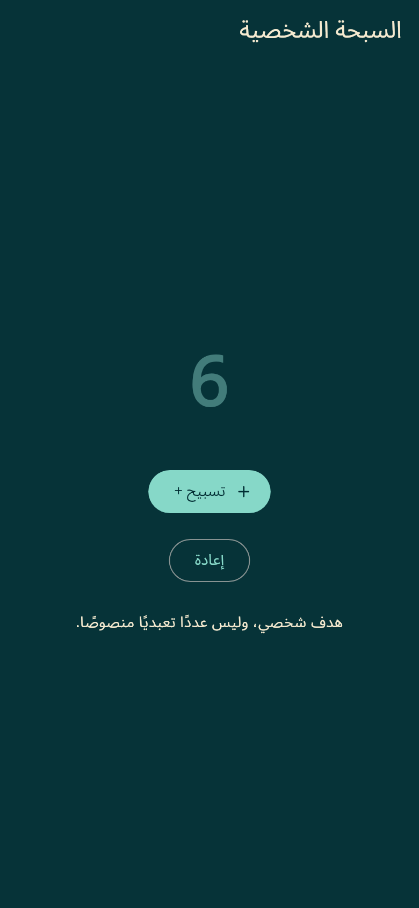
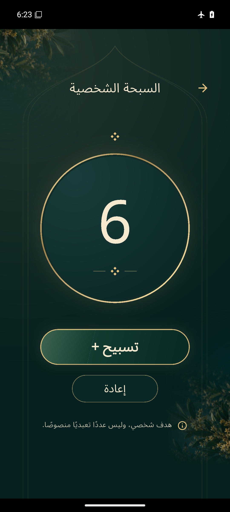

# Premium Personal Tasbih — verified review

The standalone Personal Tasbih redesign is implemented and verified, ready for visual approval in **draft [PR #4](https://github.com/Hmx77/Wird/pull/4)** on `redesign/premium-tasbih-20261019`, targeting the Reader review branch. Nothing has been merged or published. Package version remains `0.6.3+17`; identify this review by its run and APK hash below.

## Download and evidence

- **[Download wird-debug-apk](https://github.com/Hmx77/Wird/actions/runs/39376665711/artifacts/12243887475)** — ZIP contains exactly `app-debug.apk`.
- **[Successful full native review #122](https://github.com/Hmx77/Wird/actions/runs/39376665711)** — offline Android checks and review-gallery commit succeeded.
- [Android build/test job #121](https://github.com/Hmx77/Wird/actions/runs/39375572583/job/118472856107), [iOS build/test/simulator job #121](https://github.com/Hmx77/Wird/actions/runs/39375572583/job/118472856502).
- [Android build/test report](https://github.com/Hmx77/Wird/actions/runs/39375572583/artifacts/12243193971), [iOS report](https://github.com/Hmx77/Wird/actions/runs/39375572583/artifacts/12243802011), [Android device report](https://github.com/Hmx77/Wird/actions/runs/39376665711/artifacts/12244042026).
- [Actual 66-second counter/restart/reset recording](review-images/android-native/tasbih-interactions.mp4), [actual interaction result](review-images/android-native/tasbih-interactions.json).

| Original screen — real Flutter fixture render | Redesigned screen — actual Android emulator |
| --- | --- |
|  |  |

The before fixture reproduces the original standalone class in a root test route; it is not claimed as an Android capture. The after image is an unretouched screenshot from the installed final APK after six real button taps. The reference's number 6 is not hardcoded in production.

Additional real Android captures: [zero](review-images/android-native/android-tasbih-zero.png), [25 rapid taps](review-images/android-native/android-tasbih-rapid.png), [31 after process restart](review-images/android-native/android-tasbih-persisted.png), [reset to zero](review-images/android-native/android-tasbih-reset.png), [200% system text](review-images/android-native/android-tasbih-large-text.png), [320dp small phone](review-images/android-native/android-tasbih-small.png). Small screens scroll to the remaining content; the small capture is an above-fold viewport, not a claim that all content fits without scrolling.

## Actual verification

| Check | Executed result |
| --- | --- |
| Dependency resolution and Flutter doctor | Ran on Linux/macOS; mobile builds succeeded. Doctor also notes unrelated hosted-runner Linux desktop/toolchain and extra SDK-license limitations; this is not an all-platform green-doctor claim. |
| Flutter analysis | No issues on Linux/macOS |
| App tests | **139 passed on each platform** |
| Separate branding test | **1 passed on each platform** |
| New coverage | 25 Tasbih tests, including all 10 themes × Arabic/English at 320×568 and 200% text |
| Counter tests | 100 rapid widget taps: 6→106, persisted preference checked; substantial reset cancel/confirm, isolation of other progress/favorites/prayers, haptics on/off platform-channel calls, reduced motion and large-number fitting passed |
| Android packaging | Passed in #121; multi-ABI debug APK |
| iOS | Unsigned device and simulator builds passed; actual iOS 26 simulator install/launch/Home capture passed. Native iOS Tasbih interaction testing is not claimed. |
| Offline Android counter | Six taps→6; 25 rapid taps→31; actual process restart retained 31; reset→0 |
| Native accessibility/layout | Counter/reset worked at 200% Android text and 320dp; real captures inspected |
| Other native regressions | Home categories/shortcuts, Nawafil tracking, Settings reminder time/switches/persistence/privacy/licenses, Library search/bookmarks, Reader count/Undo/restart/navigation/evidence and all 30 Al-Mulk markers passed |
| Approved startup | Cold/warm launch passed; 0.0s longest flat interval, 34 cinematic candidate frames; one reusable activity |
| Runtime | No fatal runtime errors; one transient UI automation null-root warning recovered and subsequent checks passed |

Native #122 uses **the exact #121 APK**, without rebuilding or substituting another app. Both artifact ZIPs were fully downloaded and checked against their GitHub SHA-256 digests. Final APK: **168,565,858 bytes**, SHA-256 `94fb363f1e17003c9fb3788004243f2e9ef3aa7340975668eaff3768eaad128f`. ABIs: arm64-v8a, armeabi-v7a, x86_64. The final ZIP lists only `app-debug.apk`. See [inspection data](tasbih-apk-inspection.json). Artifacts are currently available until 3 November 2026.

## Implementation and preservation

`lib/tasbih_ui.dart` contains real responsive widgets: midnight teal, a warm cream count inside a gold rim, refined count/reset pills, thin architectural detailing, directly painted diamond ornaments and subtle foliage. The existing original 81 KiB botanical asset is reused with independent four-edge fades; the reference screenshot is not a UI background. Its provenance remains in `nawafil-artwork-provenance.json`. No new dependency, media recording, network request or backend was added.

The circle is display-only. One counting-button event adds exactly one, uses the saved haptic preference, and persists through the unchanged `WirdState.setTasbih` mechanism and `tasbih` key. Number fading and restrained ring/scale feedback respect reduced motion. Reset clears only personal Tasbih; counts of 100 or more request confirmation. That threshold is an accidental-loss safeguard, not a prescribed religious target. The original personal-goal disclaimer is preserved.

The main/Home integration adds only the part declaration and replaces only the standalone Tasbih class with a delegating class. All **111 protected source/native/asset blobs** still match the Reader base. Separate opening/launcher and Reader guards passed. All **12 shipped local assets** match approved Git blob hashes. Splash, launcher, Home layout, Nawafil, Settings, Library/Reader, sujood, ten palettes, content, prescribed counts, services and data keys are preserved. No religious text or authenticity claim was introduced; the existing source-checked/withheld catalog and independent proofreading requirement remain unchanged.

App source was built from `12d98b68eb31bcf96dc75263aac43591f03861fb`. Native review source was `0810df443e5f0dba2bcaa28b3823c6deb202d0f9`: the standalone implementation and test are copied byte-for-byte from the successful build's formatted-source report; other differences are test drivers/formatting, not runtime behavior. All 67 native evidence files were independently matched against the committed gallery blobs.

## Earlier attempts and corrections

- #117: checks/branding passed; analysis stopped at the before-fixture's missing widget key. Fixed.
- #118: analysis passed and 138 tests passed; final capture stalled inside the simulated test clock. Canceled and moved image generation/writing together into `runAsync`, matching the established Reader harness.
- #119: both platform jobs passed analysis, 139 tests + branding, Android packaging, unsigned iOS device/simulator builds and iOS launch. Visual review found a missing ornamental glyph and flat foliage. Replaced the glyph with painted diamonds and reused owned botanical artwork. Overall run canceled for that refinement; its APK is intermediate.
- #120: Android checks/build passed. Actual render exposed foliage crop edges, corrected with four-edge masks. Native testing confirmed the actual count `1, عداد السبحة الشخصية`; its old selector expected a bare `1`. The native drivers now match the exact accessible value. Replay of the real XML matched 1 and rejected 0/11. App logic did not change for this correction. Overall run canceled while final-source work proceeded.
- #121: both platform jobs succeeded. Overall workflow failed on that obsolete native selector and the strict stale-head gallery guard after the review-driver/format commits. It is not represented as a successful full workflow.
- **#122: full corrected native run and gallery succeeded** on the identical final APK. This is the delivery run.

Changed files are grouped around the new standalone part, exact main/Home integration, 25 regression tests and original-screen fixture, preservation manifests/checks, native drivers/CI artifact handling, and review evidence/documentation. Approved runtime screens and native platform configuration were not redesigned.

## Remaining limitations

Physical haptic feel and physical-device visual/accessibility review remain for final user acceptance. The Android debug certificate differs from the earlier Reader build: in-place updates may be rejected, and uninstalling an existing copy would erase local progress. Stable owner-controlled signing is needed for reliable updates. This is not a release-signed APK. Apple team/App Group provisioning and physical-device distribution remain external release requirements. Repository visibility was not changed. No merge or store publication occurred, no signing secrets were added, and cloud metadata stayed blocked before tool startup.
