# Two premium appearances — verified delivery

21 October 2026 (Asia/Dubai). [Draft PR #5](https://github.com/Hmx77/Wird/pull/5), branch `redesign/two-premium-themes-20261020`, targets the approved `redesign/premium-tasbih-20261019` review branch, not main. No merge or publication.

## Implemented

Exactly two selectable appearances share the existing layouts, navigation, worship logic and offline data: **Midnight Teal / داكن** (default) and **Ivory Serenity / فاتح**. Ivory uses coordinated parchment surfaces, forest-green text, sage controls, champagne accents and original optimized local sunlit botanical artwork. The approved dark artwork remains intact. This is a real Flutter implementation, not a static screenshot or color inversion.

Central `AppAppearance` tokens and ThemeData cover Home, Library/search, Reader/Quran/evidence/counters, Favorites, Nawafil, Personal Tasbih, Settings, navigation, dialogs and controls. Selection applies live and persists using stable `appearance.v2` IDs. The original wordmark silhouette and kasra are preserved; its light-mode presentation is tinted. Bedtime keeps its night illustration and readable cream labels in both modes.

| Legacy saved index | Migrated appearance |
| --- | --- |
| 0, 1, 2, 3, 4, 7, 9 | Ivory Serenity |
| 5, 6, 8 | Midnight Teal |
| Missing or invalid | Midnight Teal |

A valid stable ID takes precedence. Migration preserves the old index and all unrelated preferences. No reset, restart or internet connection is needed to switch.

Changed implementation: `lib/appearance.dart`, theme/state integration in `main.dart`, presentation adaptations in `premium_ui.dart`, `reading_ui.dart`, `nawafil_ui.dart`, `tasbih_ui.dart`, `settings_ui.dart`, `feature_panels.dart`, and the translated theme labels. One 169,246-byte local WebP was added; see [artwork provenance](appearance-artwork-provenance.json). No packages, recordings, accounts or backend were added. App version stays 0.6.3+17; identify this review APK by its run and SHA256 below.

## Final evidence and download

**[Final workflow #130 — SUCCESS](https://github.com/Hmx77/Wird/actions/runs/39558077077)**

- **[Download wird-debug-apk](https://github.com/Hmx77/Wird/actions/runs/39558077077/artifacts/12327556051)** — archive contains exactly `app-debug.apk`.
- [Actual Android screenshots, interaction JSON, videos and logs](https://github.com/Hmx77/Wird/actions/runs/39558077077/artifacts/12327556064).
- [Successful Android build/test job](https://github.com/Hmx77/Wird/actions/runs/39556769240/job/119078249033).
- [Successful iOS build/test and native simulator job](https://github.com/Hmx77/Wird/actions/runs/39556769240/job/119078249316).
- [Android build/test report](https://github.com/Hmx77/Wird/actions/runs/39556769240/artifacts/12325384661) and [iOS build/test report](https://github.com/Hmx77/Wird/actions/runs/39556769240/artifacts/12326835526).

Built runtime/test commit: `1dae01da4243aa9d5cb8db30550d124839f2df65`. Final native-driver commit: `4b3d622d1e44ff882c4cd3d14ac8e809ff609b00`. Final screenshots committed by gallery job at `9e48d6dfeac45f47eb950618bfd697ef42b388d7`. The #130 run reused the exact APK built by #129; it did not rebuild or substitute an older APK.

Raw APK: **168,739,868 bytes**, SHA256 **`2458cc8a1bc457a1f3d7bf41506a35fa694f57be870c843680fc55aa4d5b7d07`**. Final artifact ZIP: 92,184,383 bytes, SHA256 `6b73ec0fc8f78ae4550b0914d2d1b1e06c3e2b260f7478c41268b70a5059e246`. Both final artifact downloads were completed and checked against GitHub's published digests. Artifacts expire 4 November 2026 under the existing 14-day retention policy; source and committed screenshot gallery remain on the branch. See [APK inspection](appearance-apk-inspection.json).

## Executed checks

| Check | Actual result and scope |
| --- | --- |
| Dependencies/doctor/content/static guards | Executed in #129 on Linux/macOS; content/static checks passed. Doctor has unrelated Linux desktop and extra Android SDK-license warnings; do not interpret this as every doctor category being green. |
| Flutter analysis | No issues, Android and iOS build jobs. |
| Automated tests | **92 app tests + 1 separate branding test on each platform**, all passed. Both appearances, Arabic/English, RTL/LTR, all ten old indices, stable IDs/recovery, rapid preference writes, data preservation, primary reading-text AA contrast, responsive and large-text regressions. Painted Bedtime labels are checked, not only semantic existence. |
| Android debug build | Successful; final #130 APK downloaded, opened and independently inspected. |
| Native Android #130 | Full offline Android 36 suite passed, with actual screenshots and interaction results. |
| Native two-theme behavior | Exactly two options; live switching; six major screens each; force-stop/relaunch persistence. Every other stored Flutter preference compared before/after each switch/restart and remained identical. |
| Existing native interactions | Home categories/shortcuts/navigation; Nawafil tracking; Library/search/bookmarks/favorites; Reader count/Undo/restart/evidence; all 30 Al-Mulk markers; three reminder switches, visible time picker to 08:15 and restart persistence; Settings personal counter/reset, haptics/advance, privacy expansion, deletion cancellation and real software licenses. |
| Standalone native Tasbih | Six taps →6; 25 rapid taps →31; process restart →31; reset →0; 200% system text and 320dp controls. |
| Startup/layout | Actual launcher tap, cold/warm launch, automated startup-frame guard (0.0s longest flat interval), small/large-font and tablet captures passed. Human device acceptance remains separate. |
| iOS | Unsigned device release Runner.app (41.7 MB), simulator debug build, actual iOS 26 simulator installation/launch and Home capture passed. No signed device/archive claim. Native iOS theme-switch interaction permutations were not executed; Flutter tests cover both appearances. |

Transient UIAutomator null-root/readiness warnings recovered during the retrying native driver. Final feature checks passed and no fatal app runtime error was found. Do not describe the logs as containing no warnings.

## Actual Android screenshot pairs

These are actual emulator captures from #130, not generated mockups. Library scroll offsets differ slightly between captures. Selector images are taken before the next selection, so their filenames refer to the upcoming choice; the table puts them under their actual displayed palette.

| Screen | Midnight Teal | Ivory Serenity |
| --- | --- | --- |
| Home | 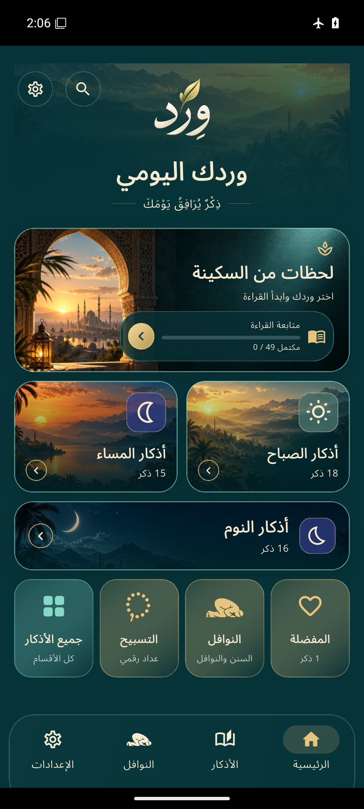 | 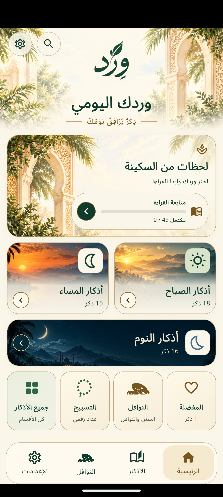 |
| Library | 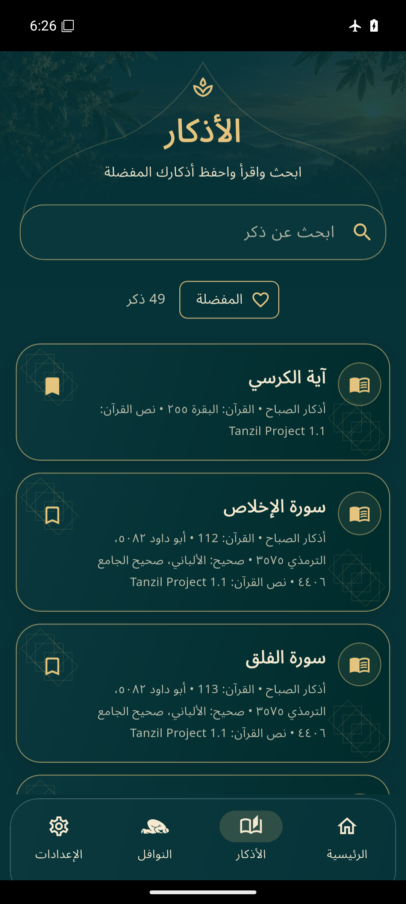 | 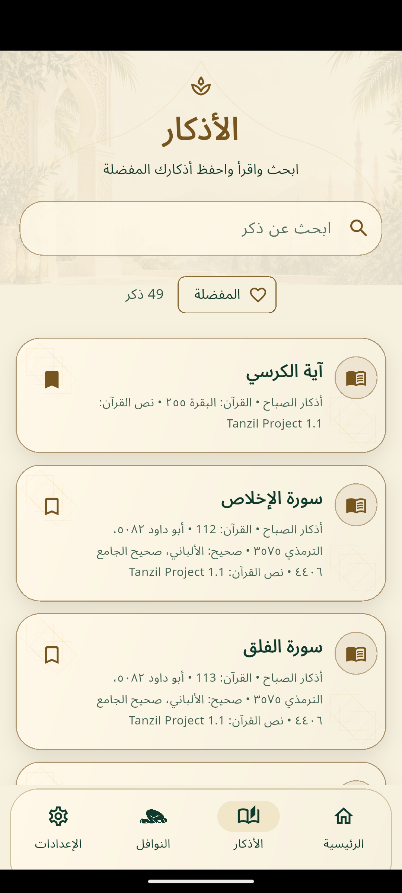 |
| Reader | 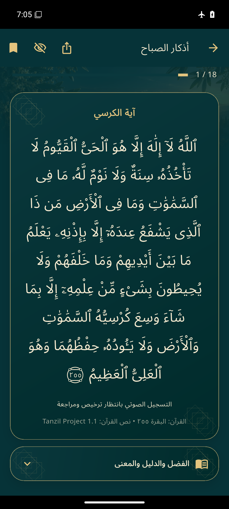 | 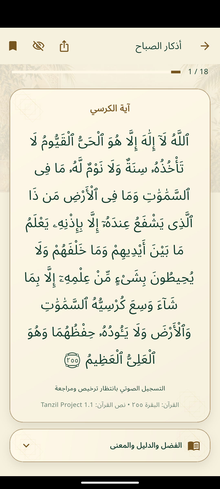 |
| Nawafil | 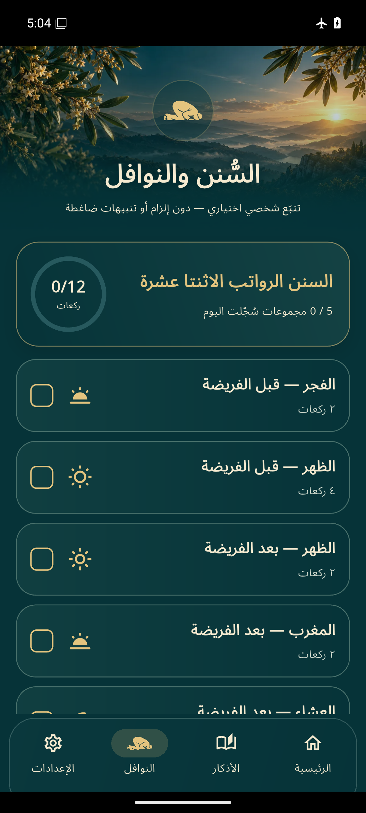 | 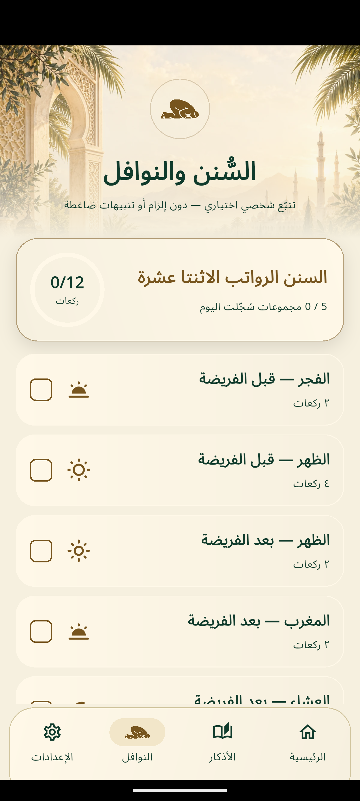 |
| Tasbih | 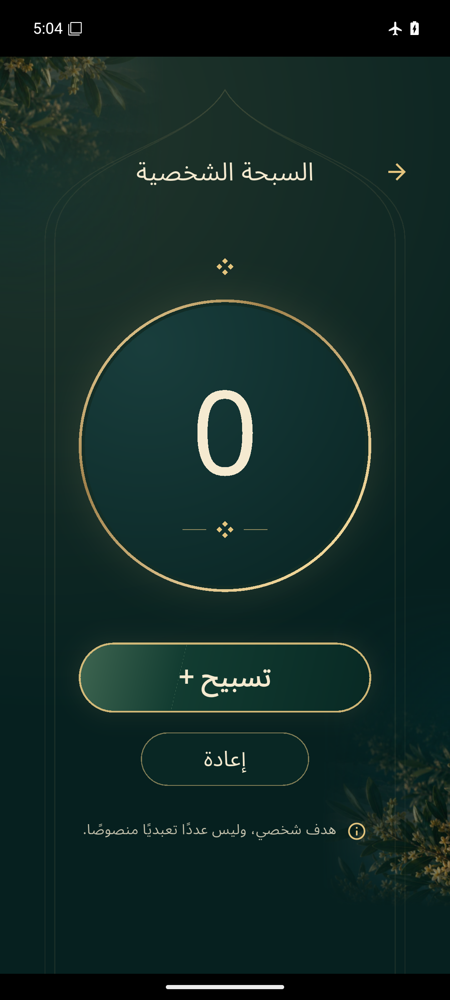 | 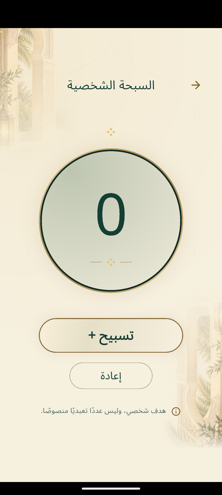 |
| Settings |  |  |
| Exactly two choices | 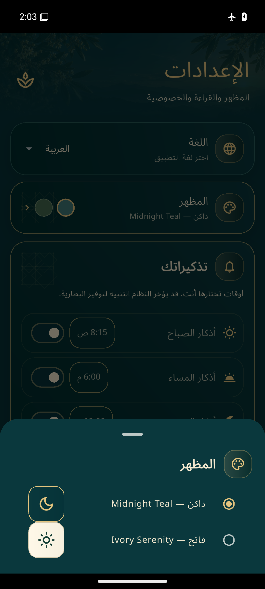 | 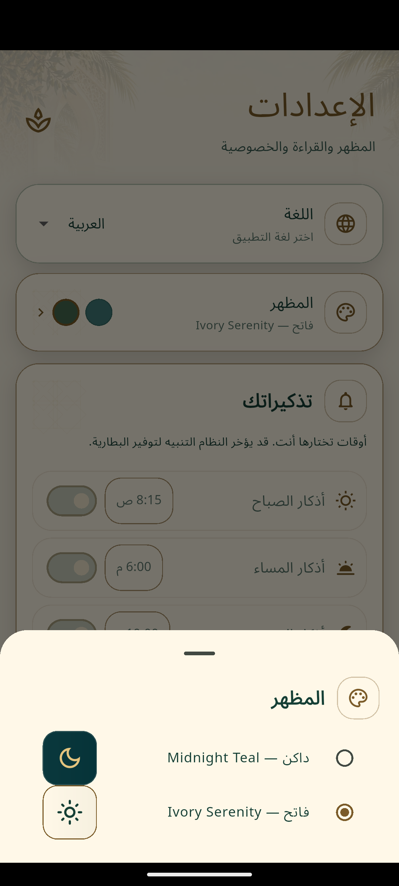 |

[Actual iOS simulator Home](review-images/ios-native/ios-home.png). Videos, JSON and full-resolution originals are in the linked device-review artifact and committed gallery.

## Preservation and independent inspection

All **107 pinned original content/service/native/asset files** match approved commit `21bd8483fb38a59b1fc349d1bc8ebaa0a98bd709` exactly in the final source tree; all 51 approved startup/launcher hashes also passed CI. Independent APK inspection confirms 12 original shipped assets match their Git blobs and the new Ivory asset matches its committed blob. Original logo files, wordmark, font/license, sanctuary and dark Home art remain exact.

[Logic comparison](appearance-logic-check.json) independently confirms exact rawatib/source-note/other-practice text, approved sujood painting geometry, `setCount`, `chooseCount`, `togglePrayer` and `setTasbih` methods. Theme changes do not alter deletion behavior or unrelated data keys.

The religious catalog remains **49 category entries: 18 morning, 15 evening, 16 bedtime**. The existing 17 withheld reference screens remain unchanged. This theme task makes no religious correction or qualified scholarly-approval claim. Audio remains gated with zero supplied recordings. Qualified religious proofreading remains required before public release.

## Earlier attempts and corrections

- #124 failed compilation on obsolete const Reader padding and a changed bead-painter constructor. Both were corrected; no successful app-test claim for that run.
- #125 analysis passed; 91 tests passed and 17 failed because tests still iterated retired palette indices and asserted the wordmark wrapper itself was an Image. Updated tests exercise the two supported modes and inspect the original descendant image; functional regressions remain.
- #126 Android/iOS build jobs succeeded with analysis, 92+1 tests and packaging; the overall run was canceled after these jobs to replace its obsolete native driver.
- #127 full native suite/gallery succeeded on the #126 APK. A scaled preview appeared to omit Bedtime labels; full-resolution crops/pixel inspection confirmed the original labels were present. A dedicated paint boundary and actual pixel-output regression assertions were nevertheless added. Capture timing was corrected so Settings is saved after the selector transition closes.
- #129 refreshed Android/iOS build jobs succeeded, including the new assertions, unsigned iOS builds and actual simulator launch. Its overall run was canceled after both build jobs succeeded to stop the duplicate native review.
- **#130 full final native suite/gallery succeeded** on the identical #129 APK with settled screenshots. Android/iOS build jobs are intentionally skipped in #130 because this run reuses the verified build.

## Remaining limitations and release requirements

This is a debug review. Its hosted-runner debug certificate differs from previous review APKs. Android may reject an in-place update; **uninstalling erases local progress**. Stable owner-controlled Android signing is required for reliable future updates. The public certificate digest is recorded; no private signing key or credential was inspected or exposed.

Apple team/certificates, App Group provisioning and a signed physical-iPhone build remain owner-account requirements. Physical Samsung/iPhone visual and vibration acceptance remain manual. No app-store upload was performed.

Metadata was blocked before tool startup and clean child environments excluded credentials; no security restriction was relaxed. Repository visibility was observed as public before this work and was left unchanged as instructed. No other repository was modified. This PR remains draft and unmerged pending owner review.
